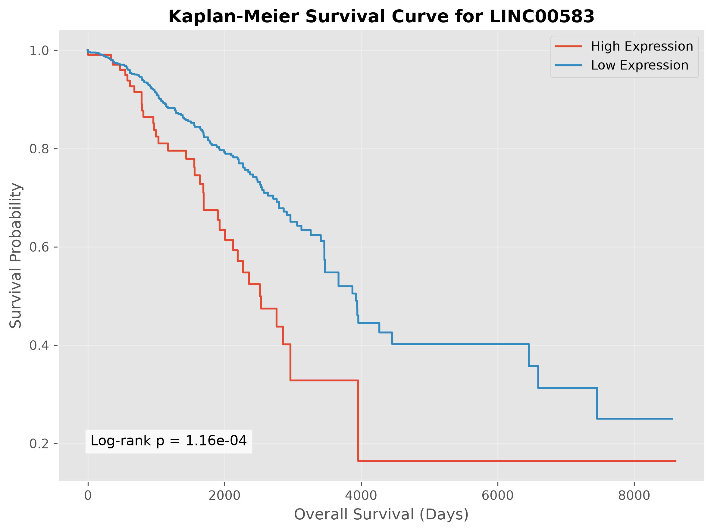
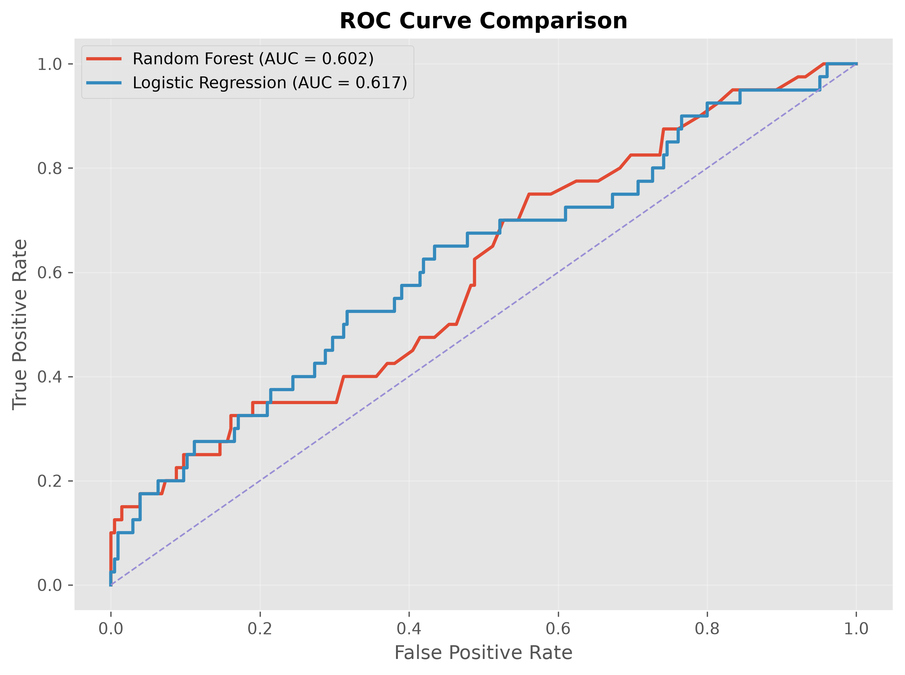
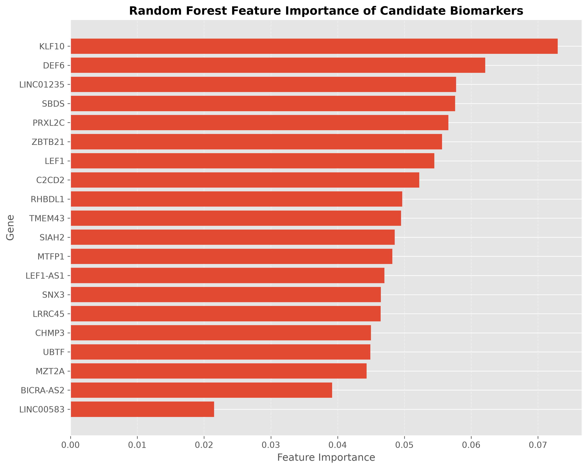

# Finding candidate survival markers in TCGA breast cancer data

I used TCGA-BRCA expression and clinical data to explore whether tumor gene-expression patterns could help identify patients with different survival outcomes. The project combines statistical screening, machine-learning baselines, and survival analysis.



## What I did

I cleaned and matched RNA-seq FPKM data to clinical records, screened expression differences with Mann–Whitney tests and false-discovery-rate correction, and narrowed the results to 20 candidate genes. I compared logistic regression and random forest models, then examined survival differences using Kaplan–Meier plots and Cox regression.

The notebook contains the analysis walkthrough: [biomarker_analysis.ipynb](notebooks/biomarker_analysis.ipynb). I also separated reusable data-loading, preprocessing, statistical, and plotting code into [src/](src/).

## Results

| Model | Accuracy | Precision | Recall | ROC AUC |
|---|---:|---:|---:|---:|
| Random forest | 0.833 | 0.467 | 0.175 | 0.602 |
| Logistic regression | 0.653 | 0.241 | 0.525 | 0.617 |

The random forest had higher overall accuracy, but its recall for the poorer-outcome class was low. Logistic regression recovered more of those cases, at the cost of lower precision. In other words, neither model is ready for clinical use.

KLF10, DEF6, and LINC01235 appeared among influential features in the random forest. LINC00583 was also associated with survival in the reported analysis, with a Cox hazard ratio of 6.34. That estimate needs independent validation and careful review of model assumptions and group sizes.





## Explore the analysis

- [Notebook](notebooks/biomarker_analysis.ipynb) — step-by-step exploratory work
- [Source code](src/) — data processing, statistical screening, and plots
- [Results tables](results/tables/) — saved statistical output
- [Figures](images/) — survival curves and model evaluation plots

To work locally:

```bash
git clone https://github.com/palrabheru/tcga-biomarker-discovery.git
cd tcga-biomarker-discovery
python -m venv .venv
# Activate .venv for your operating system
python -m pip install -r requirements.txt
jupyter notebook notebooks/biomarker_analysis.ipynb
```

The notebook relies on downloaded TCGA source data; consult its input paths before running. The requirements file is an environment snapshot rather than a minimal package specification.

## What I would investigate next

The strongest next step is independent validation, with outcome-informed feature selection contained within training folds. I'd also want to assess the impact of tumor stage, age, molecular subtype, and class imbalance. The current work is an exploratory search for associations, not proof that a gene causes a survival difference.

**Data source:** [The Cancer Genome Atlas](https://www.cancer.gov/ccg/research/genome-sequencing/tcga) · **Author:** [Pal Rabheru](https://github.com/palrabheru)
